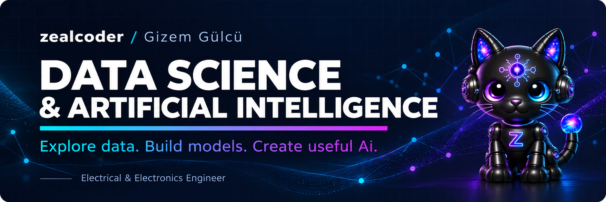
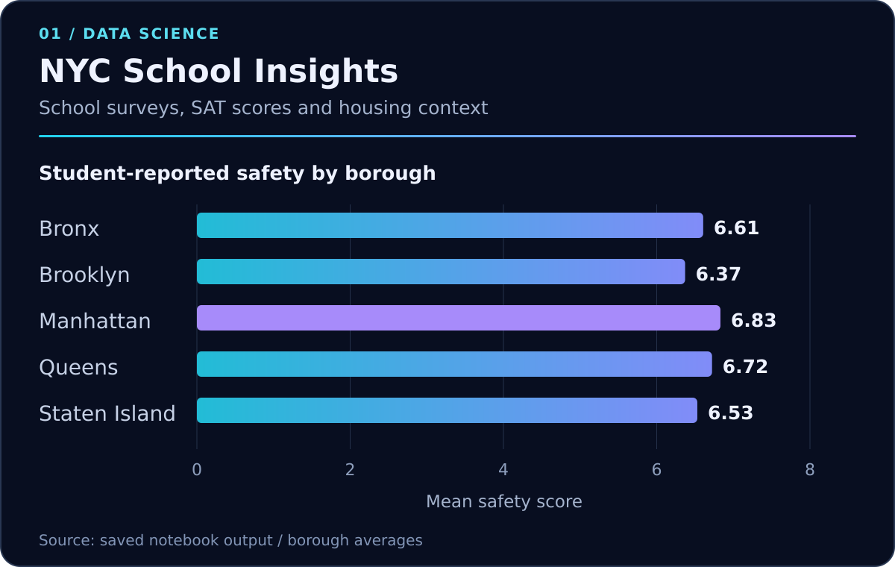
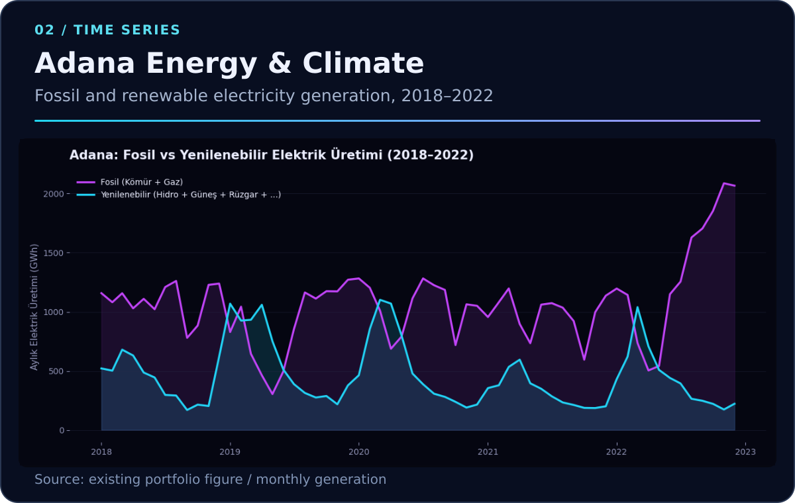
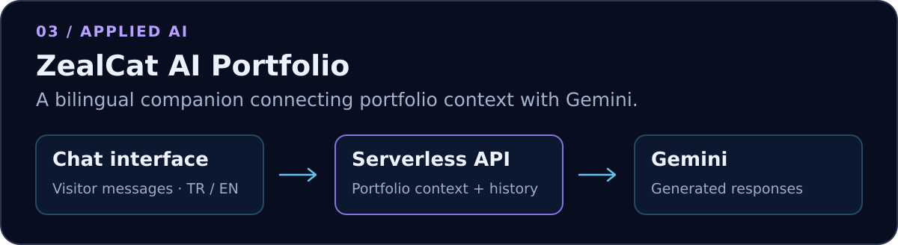

  

  <strong>Data Science · Machine Learning · Applied AI</strong> 
  Electrical & Electronics Engineer exploring data, predictive models and useful AI applications.

  
  
  

  Open to <strong>Junior Data Scientist</strong> and <strong>Machine Learning Engineer</strong> opportunities.

## Selected Data Science Projects

<table>
  <tr>
    <td width="50%" valign="top">
      
      
<strong>NYC High School Data</strong>

      
Exploring relationships between <strong>SAT performance, school surveys and property prices</strong> across New York City.

      
<code>Python</code> <code>Pandas</code> <code>Seaborn</code> <code>EDA</code>

      
<a href="https://github.com/zealcoder95/Analyzing-NYC-High-School-Data"><strong>Explore the analysis →</strong></a>

    </td>
    <td width="50%" valign="top">
      
      
<strong>Adana Energy & Climate</strong>

      
Investigating <strong>energy generation, seasonality and renewable energy</strong> through a local sustainability case study.

      
<code>Python</code> <code>Pandas</code> <code>Time Series</code>

      
<a href="https://www.kaggle.com/code/gizemglc/global-climate-change-renewable-energy-in-adana"><strong>Read the case study →</strong></a>

    </td>
  </tr>
</table>

## Applied AI · ZealCat

A personal portfolio with a **TR/EN AI companion**, portfolio-aware responses and a serverless chat endpoint. An applied AI project bringing together interaction design, context and model integration.

<code>JavaScript</code> <code>HTML / CSS</code> <code>Gemini API</code> <code>Vercel</code>

**[Try ZealCat ↗](https://zealcoder-portfolio.vercel.app/)** · [Explore the repository](https://github.com/zealcoder95/zealcoder-portfolio)

## Technical Toolkit

**Data & analytics**

  
  
  
  
  
  
  

**Machine learning**

  
  

**Engineering & delivery**

  
  
  

## More Work

| Project | Focus | Explore |
|---|---|---|
| **E-commerce SQL** | Relational database design, views, stored procedures and analytical queries | [GitHub ↗](https://github.com/zealcoder95/ecommerce-sql-project) |
| **Adidas US Sales** | Regional sales patterns, product performance and visual analysis | [Kaggle ↗](https://www.kaggle.com/code/gizemglc/adidas-us-sales-analysis) |
| **Employee Exit Surveys** | Cleaning and combining survey data to explore employee dissatisfaction | [Kaggle ↗](https://www.kaggle.com/code/gizemglc/clean-and-analyze-employee-exit-surveys-1-1) |

  <strong>Adana, Türkiye</strong> · Data Science & Applied AI. 
  <a href="https://github.com/zealcoder95?tab=overview">GitHub activity</a> ·
  <a href="https://www.kaggle.com/gizemglc/code">All notebooks</a> ·
  <a href="https://www.linkedin.com/in/gizemgulcu/">Let's connect</a>

