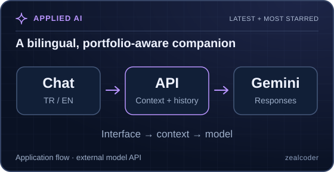
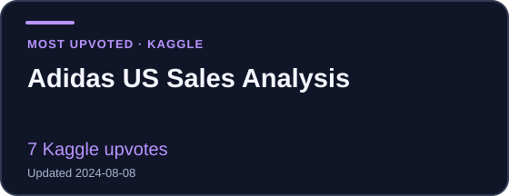
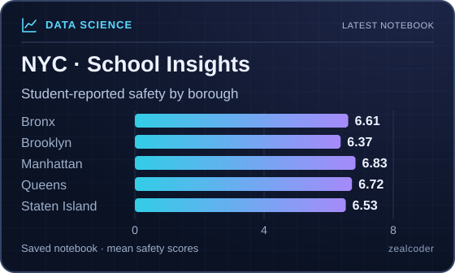
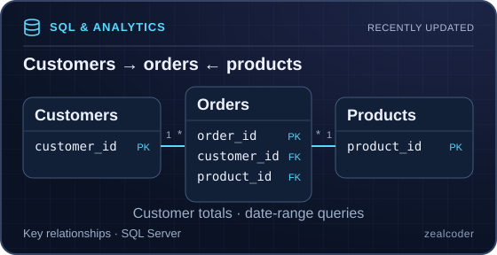

  

  <strong>Data Science · Machine Learning · Applied AI</strong> 
  Electrical & Electronics Engineer exploring data, predictive models and useful AI applications.

  
  
  

  Open to <strong>Junior Data Scientist</strong> and <strong>Machine Learning Engineer</strong> opportunities.

<!-- PROFILE:HIGHLIGHTS:START -->
## Latest & Popular Projects

<!-- Generated from public GitHub metadata and the portfolio's Kaggle feed. -->

<table>
  <tr>
    <td width="50%" valign="top">
      
      
A bilingual portfolio with a context-aware AI companion and a serverless Gemini integration.

      
<code>JavaScript</code> <code>Gemini API</code> <code>Vercel</code>

      
<a href="https://github.com/zealcoder95/zealcoder-portfolio">GitHub ↗</a>

    </td>
    <td width="50%" valign="top">
      
      
A study analyzing Adidas&#x27;s US sales data to surface the key trends and insights behind it.

      
<code>Python</code> <code>Pandas</code> <code>Matplotlib</code> <code>Seaborn</code>

      
<a href="https://www.kaggle.com/code/gizemglc/adidas-us-sales-analysis">Kaggle ↗</a>

    </td>
  </tr>
  <tr>
    <td width="50%" valign="top">
      
      
An analysis exploring the relationship between SAT scores and socioeconomic and real-estate data across New York City high schools.

      
<code>Python</code> <code>Pandas</code> <code>Seaborn</code> <code>Statsmodels</code>

      
<a href="https://github.com/zealcoder95/Analyzing-NYC-High-School-Data">GitHub ↗</a> · <a href="https://www.kaggle.com/code/gizemglc/analyzing-nyc-high-school-data">Kaggle ↗</a>

    </td>
    <td width="50%" valign="top">
      
      
Relational database design, views, stored procedures and analytical queries.

      
<code>T-SQL</code> <code>SQL Server</code>

      
<a href="https://github.com/zealcoder95/ecommerce-sql-project">GitHub ↗</a>

    </td>
  </tr>
</table>

GitHub metadata refreshes hourly; Kaggle follows the portfolio's daily feed. Stars and upvotes are ranked within each platform.
<!-- PROFILE:HIGHLIGHTS:END -->

## Selected Data Science Case Studies

<table>
  <tr>
    <td width="50%" valign="top">
      
      
<strong>NYC High School Data</strong>

      
Exploring relationships between <strong>SAT performance, school surveys and property prices</strong> across New York City.

      
<code>Python</code> <code>Pandas</code> <code>Seaborn</code> <code>EDA</code>

      
<a href="https://github.com/zealcoder95/Analyzing-NYC-High-School-Data"><strong>Explore the analysis →</strong></a>

    </td>
    <td width="50%" valign="top">
      
      
<strong>Adana Energy & Climate</strong>

      
Investigating <strong>energy generation, seasonality and renewable energy</strong> through a local sustainability case study.

      
<code>Python</code> <code>Pandas</code> <code>Time Series</code>

      
<a href="https://www.kaggle.com/code/gizemglc/global-climate-change-renewable-energy-in-adana"><strong>Read the case study →</strong></a>

    </td>
  </tr>
</table>

## Applied AI · ZealCat

A personal portfolio with a **TR/EN AI companion**, portfolio-aware responses and a serverless chat endpoint. An applied AI project bringing together interaction design, context and model integration.

<code>JavaScript</code> <code>HTML / CSS</code> <code>Gemini API</code> <code>Vercel</code>

**[Try ZealCat ↗](https://zealcoder-portfolio.vercel.app/)** · [Explore the repository](https://github.com/zealcoder95/zealcoder-portfolio)

## Technical Toolkit

**Data & analytics**

  
  
  
  
  
  
  

**Machine learning**

  
  

**Engineering & delivery**

  
  
  

<!-- PROFILE:ARCHIVE:START -->
## Project Archive

Browse all 14 public projects & notebooks

<table>
  <tr><th>Project</th><th>Explore</th><th>Community</th><th>Updated</th></tr>
  <tr><td><strong>ZealCat · AI Portfolio</strong> A bilingual portfolio with a context-aware AI companion and a serverless Gemini integration.</td><td><a href="https://github.com/zealcoder95/zealcoder-portfolio">GitHub</a></td><td>1 GitHub star</td><td>2026-10-19</td></tr>
  <tr><td><strong>Analyzing NYC High School Data</strong> An analysis exploring the relationship between SAT scores and socioeconomic and real-estate data across New York City high schools.</td><td><a href="https://github.com/zealcoder95/Analyzing-NYC-High-School-Data">GitHub</a> · <a href="https://www.kaggle.com/code/gizemglc/analyzing-nyc-high-school-data">Kaggle</a></td><td>0 GitHub stars · 3 Kaggle upvotes</td><td>2026-07-10</td></tr>
  <tr><td><strong>E-commerce SQL</strong> Relational database design, views, stored procedures and analytical queries.</td><td><a href="https://github.com/zealcoder95/ecommerce-sql-project">GitHub</a></td><td>0 GitHub stars</td><td>2026-07-10</td></tr>
  <tr><td><strong>Data Science Bootcamp Exercises</strong> Coursework and practice from the TurkStudentCo data science bootcamp.</td><td><a href="https://github.com/zealcoder95/TurkStudentCo-DSB-homework">GitHub</a></td><td>0 GitHub stars</td><td>2024-09-27</td></tr>
  <tr><td><strong>Climate Change &amp; Renewable Energy in Adana</strong> A data analysis project looking at the local effects of climate change in Adana and its renewable energy potential.</td><td><a href="https://www.kaggle.com/code/gizemglc/global-climate-change-renewable-energy-in-adana">Kaggle</a></td><td>2 Kaggle upvotes</td><td>2024-08-30</td></tr>
  <tr><td><strong>Adidas US Sales Analysis</strong> A study analyzing Adidas&#x27;s US sales data to surface the key trends and insights behind it.</td><td><a href="https://www.kaggle.com/code/gizemglc/adidas-us-sales-analysis">Kaggle</a></td><td>7 Kaggle upvotes</td><td>2024-08-08</td></tr>
  <tr><td><strong>Adidas retail strategy: An analysis of sales chann</strong></td><td><a href="https://www.kaggle.com/code/gizemglc/adidas-retail-strategy-an-analysis-of-sales-chann">Kaggle</a></td><td>0 Kaggle upvotes</td><td>2024-08-08</td></tr>
  <tr><td><strong>Employee Exit Survey Analysis</strong> A project combining and cleaning two separate exit surveys (DETE and TAFE) from Queensland, Australia education institutions to extract meaningful insights about reasons for leaving.</td><td><a href="https://www.kaggle.com/code/gizemglc/clean-and-analyze-employee-exit-surveys-1-0">Kaggle</a></td><td>1 Kaggle upvote</td><td>2024-05-18</td></tr>
  <tr><td><strong>Clean and Analyze Employee Exit Surveys_1.1</strong></td><td><a href="https://www.kaggle.com/code/gizemglc/clean-and-analyze-employee-exit-surveys-1-1">Kaggle</a></td><td>2 Kaggle upvotes</td><td>2024-05-18</td></tr>
  <tr><td><strong>Renewable Energy Analysis</strong></td><td><a href="https://www.kaggle.com/code/gizemglc/renewable-energy-analysis">Kaggle</a></td><td>0 Kaggle upvotes</td><td>2024-01-05</td></tr>
  <tr><td><strong>Credit Card Fraud Data Analysis</strong></td><td><a href="https://www.kaggle.com/code/gizemglc/credit-card-fraud-data-analysis">Kaggle</a></td><td>0 Kaggle upvotes</td><td>2023-12-31</td></tr>
  <tr><td><strong>Credit Card Fraud Detection using ML</strong></td><td><a href="https://www.kaggle.com/code/gizemglc/credit-card-fraud-detection-using-ml">Kaggle</a></td><td>0 Kaggle upvotes</td><td>2023-12-31</td></tr>
  <tr><td><strong>US Consumer Finance Complaints Analysis</strong></td><td><a href="https://www.kaggle.com/code/gizemglc/us-consumer-finance-complaints-analysis">Kaggle</a></td><td>0 Kaggle upvotes</td><td>2023-12-29</td></tr>
  <tr><td><strong>seaborn_tips_</strong></td><td><a href="https://www.kaggle.com/code/gizemglc/seaborn-tips">Kaggle</a></td><td>0 Kaggle upvotes</td><td>2023-08-20</td></tr>
</table>

<!-- PROFILE:ARCHIVE:END -->

  <strong>Adana, Türkiye</strong> · Data Science & Applied AI. 
  <a href="https://github.com/zealcoder95?tab=overview">GitHub activity</a> ·
  <a href="https://www.kaggle.com/gizemglc/code">All notebooks</a> ·
  <a href="https://www.linkedin.com/in/gizemgulcu/">Let's connect</a>

